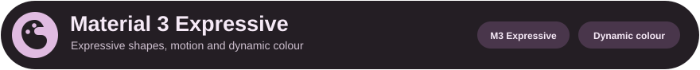
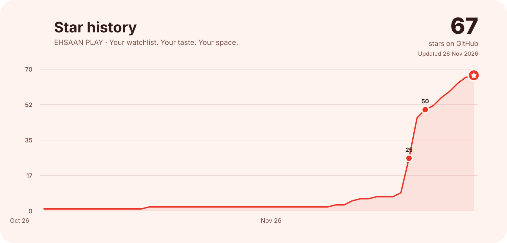

 
  
 
 
  

# EHSAAN PLAY
 ## **Your watchlist. Your taste. Your space.**
 
> [!WARNING]
> The Apk is currently in beta may have some bugs. prefer webapp for smooth experience.

 # **Your watchlist. Your taste. Your space.**
 
</a>

  <strong>Still taking screenshots of movies?</strong> 
  Try EHSAAN PLAY and track what you watch in a simple, 
  calm, and enjoyable way.

</a>
  
---

## ☁️ CLOUD DATABASE & MULTI-DEVICE SYNC

EHSAAN PLAY is **local-first with optional cloud sync**. Your library works without an account; connect your own Supabase project when you want to access the same collection across devices.

<table>
  <tr>
    <td width="50%" valign="top">

**Sync flow**

`Connect Supabase` → `Set up database` → `Verify schema` → `Register / sign in` → `Sync across devices`

  <a href="https://github.com/ehsaanullah0/ehsaanplay/blob/main/CLOUD_SYNC_ACTIVATION_GUIDE.md">
    <strong>OPEN THE CLOUD SYNC ACTIVATION GUIDE →</strong>
  </a>

Designed for large personal libraries, with capacity for approximately **60,000+ movie titles and metadata**. Actual limits depend on device storage, browser capabilities, and the configured database.

📌 **if library not sync , please reconnect your user account (sign-in again)**

---

<h2></h2>

EHSAAN PLAY is an independently developed personal-library application, not a streaming service. Movie and TV metadata, posters, and related artwork are supplied by third-party providers and remain subject to their respective terms. Features that depend on external services may change or become unavailable. The project is provided as-is, without a guarantee of uninterrupted or error-free operation. Please review the project license before redistributing or modifying the source.

> [!TIP]
> **Customise your experience:**
> - [LITE ICONS](https://github.com/ehsaanullah0/ehsaanplay/releases/download/V2.3.6/light-icos.zip) — Custom PWA logos.
> - [360+ Titles JSON](https://github.com/ehsaanullah0/ehsaanplay/releases/download/v2.4.1/ehsaan-play-360.json) — Import my thriller-taste watchlist.
 
## 🚀 WHAT'S NEW IN LATEST RELEASE

> [!IMPORTANT]
> **EHSAAN PLAY — Upcoming Features & Latest Improvements**
>
> We're working on exciting new features to make your experience better!

-  ❌ **Beautiful Analytics Page**
-  ✔ **introduce direct web search result into app**
-  ✔ **full indipendent actor profile page**
-  ✔ **new supabase multi-device sync**
</table>

✔ View COMPLETE TASKS

 

-  ✔ **Personal Favourites Category** — by [@thmeo07](https://github.com/ehsaanullah0/ehsaanplay/pull/3)
-  ✔ **Long-Press Popup Menu** inside movie image cards (v2.2.8) — by [@aleon-ty](https://github.com/ehsaanullah0/ehsaanplay/pull/4)
-  ✔ **Multi-API Fallback Support** (v2.3.0) -by [@aleon-ty](https://github.com/ehsaanullah0/ehsaanplay/pull/7)
-  ✔ **Local Wi-Fi Peer-to-Peer Sync** *(Beta)*
-  ✔ **Built-in Trailer Player** (v2.1.9)
-  ✔ **Beautiful First-Visit Guide** (v2.2.9)
-  ✔ **add imdb link metadata crowl as fallback of every service.**

## if found any bug or request any feature then please open an[ github-issue](https://github.com/ehsaanullah0/ehsaanplay/issues)

---

<h2 align="center">🎬 Watch EHSAAN PLAY in action</h2>

Take a quick tour of the interface, discover the library experience, and see EHSAAN PLAY in action.

  <a href="https://docs.google.com/videos/d/1mN3ckbE0T9zak7DC9GC1HNdonjW8Sy84P2Gqxpf9lIo/play?usp=sharing">

---

  

 

<!-- Desktop Screenshots -->

<!-- Mobile Screenshots -->

<table>
  <tr>
    <td align="center">
   
    </td>
    <td align="center">
   
  </td>
    <td align="center">
   
    </td>
  </tr>
  <tr>
    <td align="center">
   
    </td>
    <td align="center">
   
    </td>
    <td align="center">
     
    </td>
  </tr>
  <tr>
    <td align="center">
   
    </td>
   <td align="center">
   
    </td>
   <td align="center">
   

</table>

View More Screenshots

---

> [!IMPORTANT]
> ### WANT STREAMING, REFFER [VEGA-ORG](https://github.com/vega-org)
> EHSAAN PLAY is **not a streaming platform**. EHSAAN PLAY is a personal library for discovering, organizing, rating, and keeping track of movies and TV series.

---

Large movie libraries can become surprisingly heavy when posters and backdrops are permanently stored on the device.

EHSAAN PLAY therefore separates:

**Personal Data**

from

**TMDB+OMDB Artwork**

Artwork can be fetched from TMDB when needed and handled through browser caching rather than unnecessarily storing large image files inside your personal library data.

This keeps your actual library data lightweight even when your collection grows significantly.

---

Movie and TV information and artwork are provided through **[The Movie Database (TMDB)](https://www.themoviedb.org/)**.

### EHSAAN PLAY is **not affiliated with or endorsed by TMDB**.

---

## Star History

**Goal: reach 100 stars before January 2027.**

<!-- star-history:start -->
<picture>
  <source media="(prefers-color-scheme: dark)" srcset="assets/star-history/star-history-dark.svg">
  
</picture>
<!-- star-history:end -->

<h2></h2>

EHSAAN PLAY follows a simple principle:

> **Your personal library belongs to you.** There is no data collection or tracker in the webapp or apk.

The application is designed so that personal library data can remain on your device.

### EHSAAN PLAY does not need a traditional user account or personal cloud supabase is optional.

---

<h2></h2>

EHSAAN PLAY is licensed under the **GNU General Public License v3.0 (GPL-3.0)**. You may use, study, modify, and redistribute the project under the terms and conditions of that license. If you distribute a modified version, you must comply with the GPL-3.0 requirements, including providing the corresponding source code where required.

---

EHSAAN PLAY is independently developed. If you find it useful, your support helps me maintain the project, improve features, and keep building useful tools.

  

 

## MORE FROM EHSAAN

  
  
  
  

[EHSAAN QR](https://ehsaanqr.ai.studio) |
[EHSAAN FLOW](https://ehsaanflow.ai.studio) |
[EHSAAAN COMPRESS](https://ehsaancompress.ai.studio) |
[EHSAAN COLOUR](https://ehsaancolour.ai.studio)

---

This app is made by using different ai models and my creativity.

 Built with ❤️ for every movie lover
 

